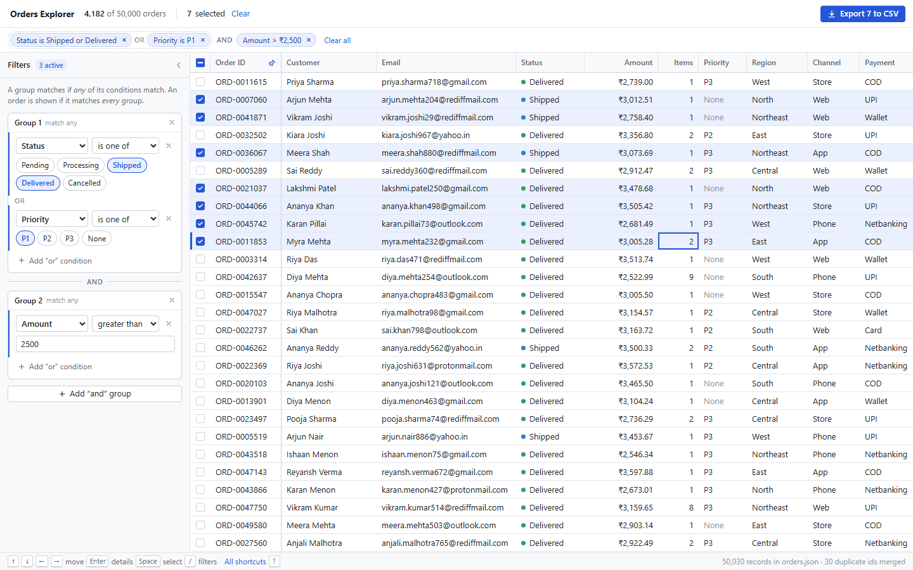
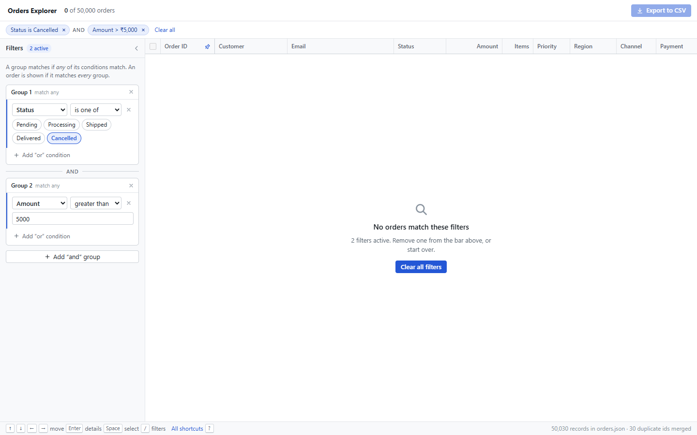
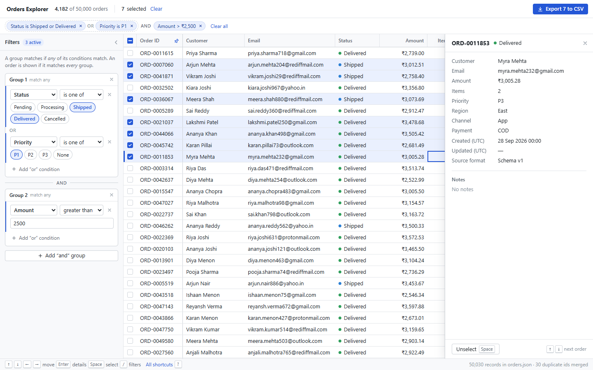
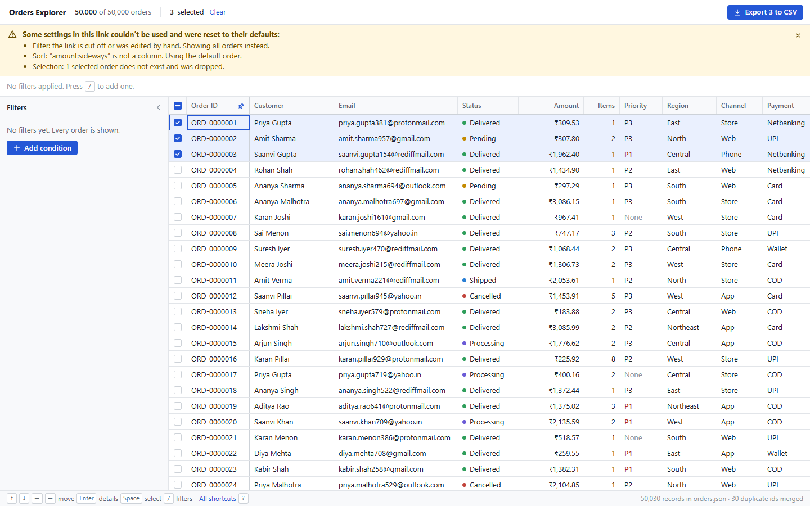

# Orders Explorer

One screen for an operations team: a hand-built, virtualized grid of 50,000 orders and a filter builder that drives it. React 19, TypeScript and Vite. The only runtime dependencies are React and React DOM.

**Live demo:** https://divyanshu-iitian.github.io/orders-explorer/



## 1. How to run it

Needs Node 24 or newer (`.nvmrc` pins 24).

```bash
npm ci
npm run dev        # http://localhost:5173
```

Other scripts:

```bash
npm test           # unit tests (Vitest), including one suite that runs the cleaner over the real orders.json
npm run build      # type-check + production build into dist/
npm run preview    # serve the production build
npm run lint       # oxlint
npm run format     # prettier
```

## 2. Screenshots

| Main screen                                                                        | No orders match                                            |
| ---------------------------------------------------------------------------------- | ---------------------------------------------------------- |
|  |                  |
| **Details panel (Enter)**                                                          | **Broken link**                                            |
|                                      |  |

Design sketches, drawn before any UI code, are in [`design/`](design/).

## 3. Dependencies

Runtime:

- `react`, `react-dom`: the UI framework the brief asks for.

That is all. The grid, virtualization, filter builder, URL state, CSV export and icons are written in this repo. Dates are formatted by hand and amounts with the built-in `Intl.NumberFormat`, so no date library is needed.

Dev only: `vite` and `@vitejs/plugin-react` (build), `typescript`, `vitest` (tests), `oxlint` (lint), `prettier` (formatting), `@types/*`.

## 4. Data loading

- `orders.json` is shipped unchanged in `public/` and fetched at runtime by a **Web Worker** (`src/data/loader.worker.ts`). The worker downloads it, runs `JSON.parse` and cleans every record, then posts the clean array back.
- Why this way:
  - Importing the file into the bundle would put 17 MB into the JavaScript and parse it on the main thread before the first paint. Fetching it keeps the app bundle at ~83 KB gzipped, and the browser can cache the data on its own.
  - Parsing and cleaning 50,030 records takes a noticeable moment. In a worker the page stays responsive and shows a real progress bar instead of freezing.
  - No backend is needed, as the brief says.
- All of `data-notes.md` is handled in one place, `src/data/normalize.ts`, before data reaches the grid or filters: the two customer-name fields, paise vs rupees, string amounts, four date formats, null/missing `updatedAt`, mixed-case status and region, duplicate ids (30 of them, resolved by the stated rules), missing priority, notes that contain HTML, and `"INR "`.
- After loading, `src/data/orderIndex.ts` builds column arrays (lower-cased text, `Float64Array`s for numbers and dates). Filtering and sorting read only those arrays, so a filter pass over 50,000 rows takes about 15 ms.

## 5. The 200 rows question

**Choice: export the 20 that are visible, and keep the other 180 selected but hidden.**

- The top bar says `20 selected · 180 more hidden by filters`, and the button says `Export 20 to CSV`. The file contains exactly those 20 rows, in the grid's current order.
- If the filter is loosened, the 180 come back already selected. Nothing the user did is thrown away. "Clear" clears all 200.
- Why: an export should match what the user is looking at. Exporting rows the user can't see (200) is surprising and easy to get wrong when the file goes to someone else. Clearing the selection whenever the filter changes (0) would throw away work, which hurts when someone narrows the filter just to check something. Keeping the hidden rows but counting and exporting only the visible ones avoids both problems, and the "hidden by filters" note makes it clear what is happening.

## 6. Design changes from the sketch

The layout follows the sketch: filters on the left, chips above the grid, count and Export in the top bar, details in a right-hand panel. Differences:

- **Condition rows use two lines, not one.** Field and operator sit on the first line and the value goes below. In a 300 px panel, date ranges and the status options did not fit on one line.
- **No Ctrl+Backspace to clear filters.** The sketch's empty state mentioned it. I dropped it because the one-click "Clear all filters" button and the removable chips already cover it, and another shortcut was one more thing to learn.
- **Added a status bar** with the main shortcuts and how many records were read and merged. The sketch only had a hint line.
- **A pinned column moves to the far left.** The sketch only showed Order ID, which is already first. Pinning a column from the middle and leaving it there looked broken while scrolling sideways, so pinning now moves the column next to the checkbox column.

## 7. Known issues

- **Very fast scrolling isn't perfectly smooth everywhere.** In a headless Edge profile (software rendering, no GPU), a 100 px-per-frame scroll ran at about 60 fps, but a 400 px-per-frame fling dropped to about 20 fps. Most of that time is the browser's own style and paint work, not React. I have not tested on a low-end laptop.
- **The first sort on a column takes ~100–250 ms** in the same headless profile, then it is cached. Sorting itself takes ~30 ms in Node; the rest is re-rendering the rows.
- **Column resize is mouse-only.** There is no keyboard way to resize.
- **Header buttons are not in the tab order.** This is on purpose, because the grid is a single tab stop. Keyboard users sort and pin with `S` and `P` on the focused column, which is listed in the `?` dialog. A user who doesn't know that could miss it.
- **Hidden selected rows can't be listed.** You see their count, but there is no "show only selected" view.
- **Dates are shown and filtered in UTC**, as the data notes say. The column headers say "(UTC)", but an India-based team might expect IST.
- **Not built for phones or touch.** The layout has a 960 px minimum width.
- **No end-to-end tests in the repo.** Interactions were checked with throwaway Playwright scripts during development. The automated tests are unit tests for the data cleaning, sorting, filtering, URL handling, selection and CSV code (80 tests).
- **Not tested with a real screen reader.** The grid uses `role="grid"`, `aria-activedescendant`, `aria-selected` and `aria-sort`.

## Keyboard

| Keys                    | Action                                          |
| ----------------------- | ----------------------------------------------- |
| Arrow keys              | Move the focused cell (Ctrl jumps to the edge)  |
| Home / End, PgUp / PgDn | First / last column, page up / down             |
| Enter                   | Open details for the focused row (Esc closes)   |
| Space                   | Select / unselect the focused row               |
| Shift + ↑ / ↓           | Extend the selection                            |
| Ctrl + A                | Select / unselect all shown rows                |
| S / P                   | Sort by / pin the focused column                |
| /                       | Jump to the filters (Esc goes back to the grid) |
| ?                       | All shortcuts                                   |

Mouse: click toggles a row, Shift+click selects a range, double-click opens details, drag a header edge to resize (double-click resets).

## What's in the URL

`?f=…&sort=-amount&pin=customer&sel=r12-40.97`

- `f`: filter groups as `[field, operator, values]` tuples. Values are kept exactly as typed, so a half-finished condition survives a refresh.
- `sort`: column key, with a `-` prefix for descending.
- `pin`: column key, or `none`. Order ID is pinned by default.
- `sel`: selected order numbers as ranges, or as a bitset when that is shorter. Selecting all 50,000 rows is `r1-50000`.
- Each part is checked on its own. A bad part falls back to its default and a banner explains what was reset; the rest of the link still applies.
- Column widths and the collapsed filter panel are personal preferences, so they are stored in `localStorage` instead of the URL.

## Project layout

```
src/
  data/       loading (worker), cleaning, field metadata, column index
  grid/       DataGrid, header cells, columns, virtualization, sorting, selection
  filters/    filter model, compiler, chip labels, builder panel, chips
  url/        URL parsing/serializing, selection codec, sync hook
  export/     CSV
  explorer/   the screen: wires state, grid, filters, URL and export together
  components/ smaller UI pieces (details panel, banners, dialog, icons)
design/       sketches made before coding
```
